# EMBERFALL: The Ashen Vow

  

An original side-scrolling arcade brawler in the spirit of the 90s classics. The art, music and sound effects are all generated in code. There are no external assets, no dependencies and no build step.

**Play it:** https://cooldance84.github.io/Emberfall/

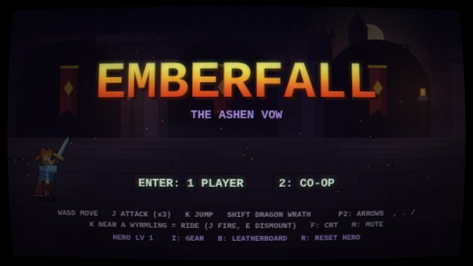

## Three heroes
Press Enter (or 2 for co-op) and pick your hero. Each one keeps their own level and gear.

| Hero | Main stat | Style |
|---|---|---|
| **Nolan**, warrior | STR | Sword, 3-hit combo that ends in a knockdown, the most health |
| **Panni**, sorceress | INT | Fires arcane bolts from range; the third cast is a big piercing blast. Fills Dragon's Wrath 50% faster, but has less health |
| **Luca**, rogue | DEX | Twin daggers, fast 4-hit combo, higher crit and speed, jumps higher. Hits from behind are backstabs for +50% damage |

In co-op the second player picks a hero too and shares the first player's level and gear.

Each hero reads at a glance, even at 40 pixels tall:
- **Nolan** wears a closed steel helm with a gold stripe and a red plume that trails behind him, broad pauldrons, a gold crest and a red cloak.
- **Panni** has a pointed purple hood, a flared robe with a gold hem, a staff with a glowing orb and runes drifting around her free hand.
- **Luca** crouches under a deep green hood, a dark mask with glowing eyes and a long scarf that streams behind him, with a dagger in reverse grip at rest.


## The story

The Cinder King stole the Heart-Ember and the world went dark. You are Nolan, the last Ember Warden, and you fight through five stages to bring the flame home.

| Stage | Setting | New monster | Boss |
|---|---|---|---|
| 1 | The Broken Gate | Ashen Husk, Cinder Brute | Cinder Colossus |
| 2 | The Sunken Marsh | Bog Wisp (floats, shoots orbs) | Mire Matron |
| 3 | The Ember Forge | Slag Runner (telegraphed dash) | Forgemaster |
| 4 | The Obsidian Throne | Throne Guard (shield blocks light frontal hits) | Cinder King |
| 5 | The Heart-Ember Sanctum | Ember Wraith (teleports behind you) | Ember Wyrm |


| | |
|---|---|
|  | 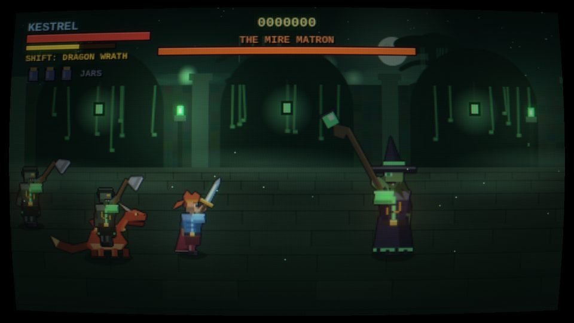 |
| 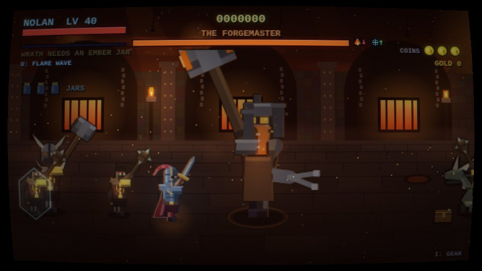 |  |


Each boss arrives with a short letterboxed intro, has its own attack set and enrages at half health.

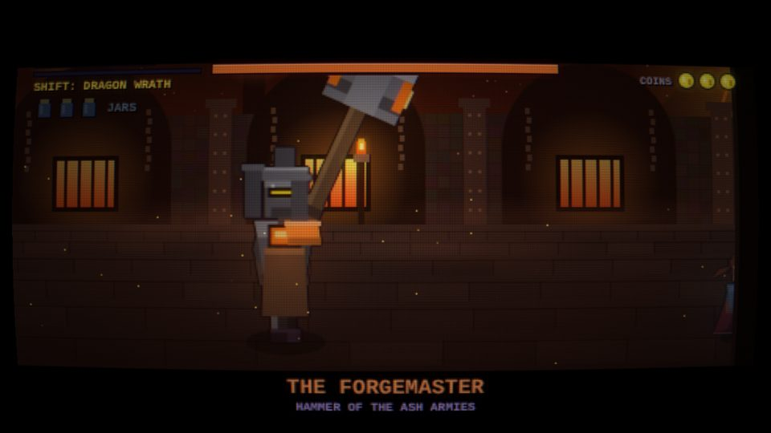

## Features

- **English and Hungarian (magyar):** pick the language on the title screen (click the box or press H) or in the pause menu. English is the default, and your choice is remembered. Translations live in `i18n.js`.
- **Your gear shows on the hero:** each rarity changes the look of the helm or hood (iron, visored, gold, crown of flame), the armour (steel, blue, gold with spikes, obsidian with ember cracks), the boots, the amulet gem and the blade or staff (rusty, steel, glowing blue, golden, flaming). Set pieces glow set-green.
- **New monsters in later acts:** frost archers (act II) shoot arrows you can jump over, blaze bombers (act III) run up and explode in a shockwave, and hollow knights (act IV) leap across the screen and crash down with a shockwave.
- **Articulated bosses:** the Colossus swings a stone back-arm, the Matron reaches with ghostly arms and living hair, the Forgemaster works a tongs arm, and the Cinder King's wings flap on shoulder, elbow, wrist and finger bones.
- **Casters that make you think:** the **Ash Warder** (from stage 2) hides inside an arcane barrier and is untouchable until you shatter it. Light hits barely crack it, heavy blows (third combo hit, jump attack, skills) break it fast, and a broken barrier knocks the warder down. Some foes (from stage 2) also arrive already wrapped in a barrier, so shatter it before you go for them. The **Flame Caller** (from stage 3) marks the ground under you with runes that explode and leave burning pools, so keep moving.
- **Chasms and barricades:** from stage 1 the road is cut by chasms you must jump over and rubble barricades you have to vault. Falling in costs 60% of your health (and kills you if you are already hurt); knocking a monster into a chasm finishes it off.
- **Sharper fights:** monsters move faster and attack more often, **elite** monsters (a golden rim light, more health and damage, extra loot) turn up from stage 3, and **ambushes** send fresh foes in from both sides when a wave is nearly beaten. Once a foe has stepped onto the screen it stays on it: nothing can be shoved or walk off the edges (thieves and goblins can still escape).
- **Tougher bosses:** more health and poise, quicker attacks, and they call in escorts when they enrage.
- **Wyrmling mounts:** a rare enemy (at most one per wave) arrives on a small dragon. Knock the rider off, then press K next to the wyrmling to ride it and breathe fire with J.
- **Dragon's Wrath (Shift):** a giant dragon head smashes the whole screen (its eyes, cracks and throat glow in your element's colour: fire, frost or lightning). Goblin pilferers carry **Ember Jars**: each jar you take adds +15% wrath damage, up to three jars (+45%).
- **RPG layer:** levels up to **70**, then **paragon points** (up to 100; each one adds 0.8% life, 0.7% damage and 0.3% damage reduction, shown as a blue +N after the level). Items roll **STR, crit chance, crit damage and hit chance**. Gear has six slots (helm, armor, boots, weapon, ring, amulet), and what you wear shows on the hero.
- **Elements (fire, frost, lightning):** choose one at level 10 at the Blacksmith; it grows a tier every 10 levels (seven tiers), and paragon 10, 20 and 30 add tiers VIII to X (+1, +2, +3 to all its modifiers). Hits build up burning, chill/freeze or shock, which deal damage over time and can stack up to three layers. They play rock-paper-scissors (frost beats fire, lightning beats frost, fire beats lightning), monsters show their element as a coloured ring under their feet, and bosses carry weaknesses and resistances but are never immune. Recasting a skill on a foe still under your element doubles the effect.
- **Gear sets:** Vowbound (crit), Bulwark (life and resist) and Emberheart (strength, element power, extra damage to afflicted foes). Wear 2 or 4 pieces for bonuses, and mix sets freely. Set pieces drop from item level 50 and are always better than a mythic of the same level; bosses drop them more often at level 70.
- **Treasure chests, shrines and combos:** chests hide gold on the road. Now and then a **shrine** stands by the road (one is guaranteed every fourth stage); strike it for a random blessing the whole party shares (haste, fury, warding, wisdom, fortune or elemental surge), and a rare golden shrine grants a few seconds of invulnerability. Killing foes in quick succession builds a **kill combo** with bonus XP that breaks when you get hit.
- **Bonus stage:** after the act bosses a Goblin Treasury opens: fast goblins, loot chests and ten seconds of raining gold, with time to gather the loot afterwards.
- **Endgame:** after the final Ember Wyrm a grand finale awaits, and then **Ember Trials I to X** raise monster life and damage step by step, with better rewards and the extra forge levels. The **daily challenge** (press 3 on the title screen) is a race with a fresh level-1 hero and a rule of the day: be first to reach level 70 + 100 paragon, the shortest play time wins. Only a crown reaches your saved hero. See below.
- **Loot by stage:** five rarities: common (white), magic (blue), rare (yellow), legendary (orange) and mythic (crimson). Stage 1 drops only white items, stage 2 adds magic, stage 3 adds rare and legendary, and mythic appears from stage 4.
- **The Blacksmith:** after the market at the end of every stage, forge all your gear up to **+7** for gold (**+8 to +10** unlock as you clear Ember Trials). Each level adds 10% to the item's stats and +2 to your main stat; from +4 a forge can fail and eat the gold. The forge level shows in the top left corner of every item.
- **3 continue coins** per run, and you can buy more in the Ember Market (up to 9; each one past the third costs more). Unspent coins are worth 1,500 points each when you win.
- **Runs are saved on your device:** close the game mid-campaign and pick the same hero later to continue the stage for **one continue coin**, or start over. With no coins left, the run is over.
- **Monsters grow with the story:** every act adds a layer of monster health (+20%, +45%, +75%), and a hero far above the stage's level meets monsters of their own level.
- **Leatherboard:** top 10 scores with initials (**B** on the title screen), kept on this device. The daily challenge has its own, separate board (**N** on the title screen, or the button on the daily rules page). Your character, gear, settings and the boards are saved in your browser.
- **Cloud save:** with the online features on, **C** on the title screen (or the button beside the language switch) uploads your heroes under a private sync code and downloads them on another device, so the phone and the PC can share them. Every overwrite asks for a second press, a hand-edited save is never uploaded, and the crown count only ever grows. In the daily race a pace line shows the fastest finished time to beat.
- **2-player co-op:** press **2** on the title screen.
- **Procedural music** for each stage, a **pause menu**, **gamepad** and **touch** support.
- **CRT and bloom shader** (WebGL), per-stage lighting, fog and parallax.

| | |
|---|---|
|  | 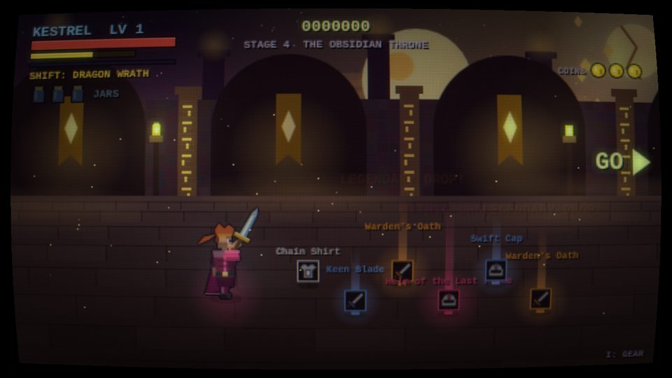 |
|  |  |
|  | 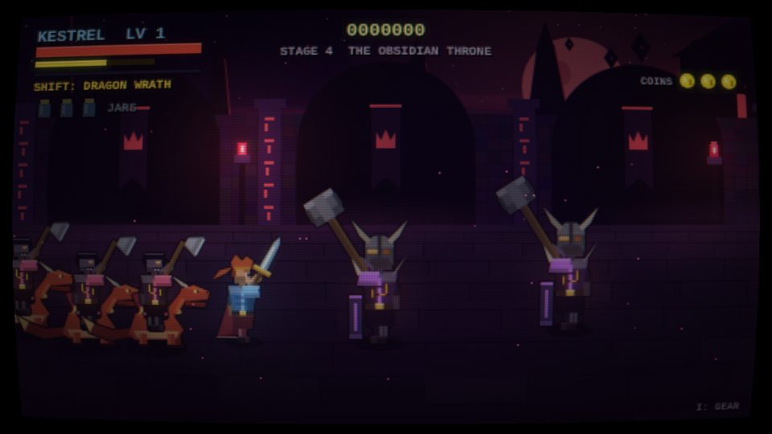 |
| 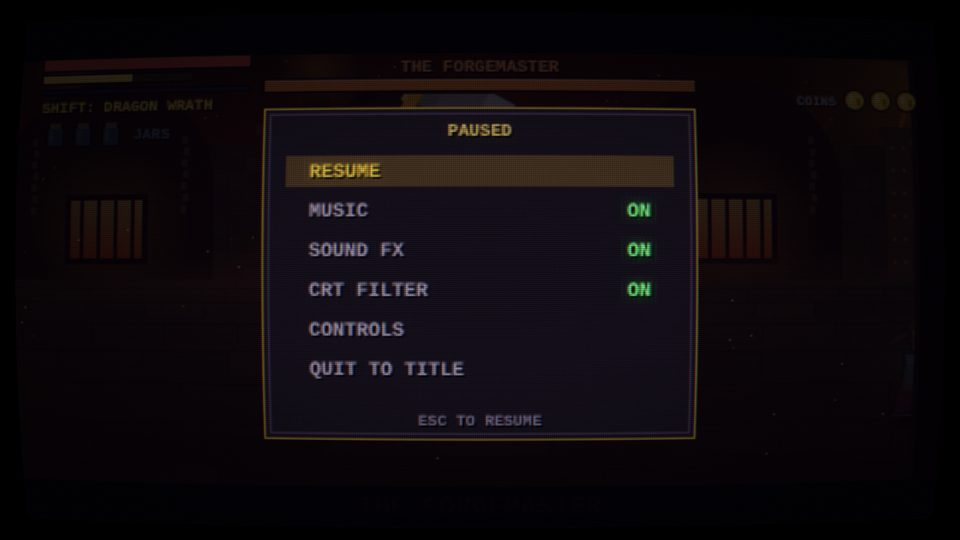 |  |
|  |  |
|  | 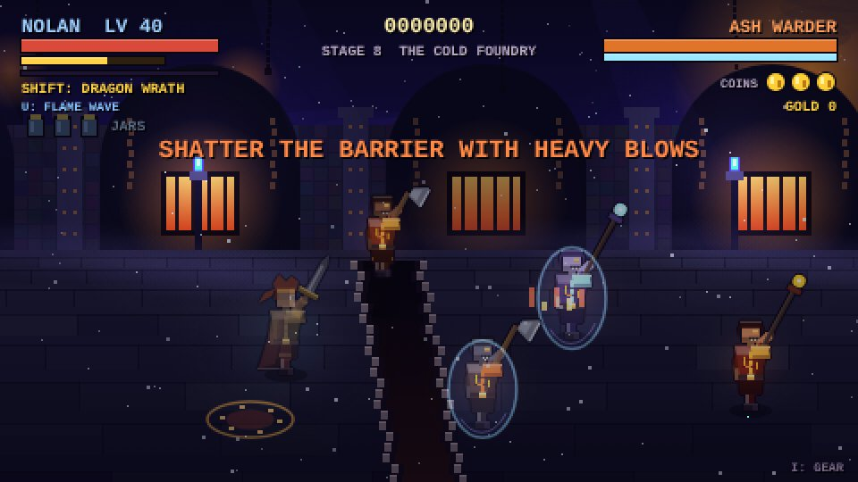 |
| 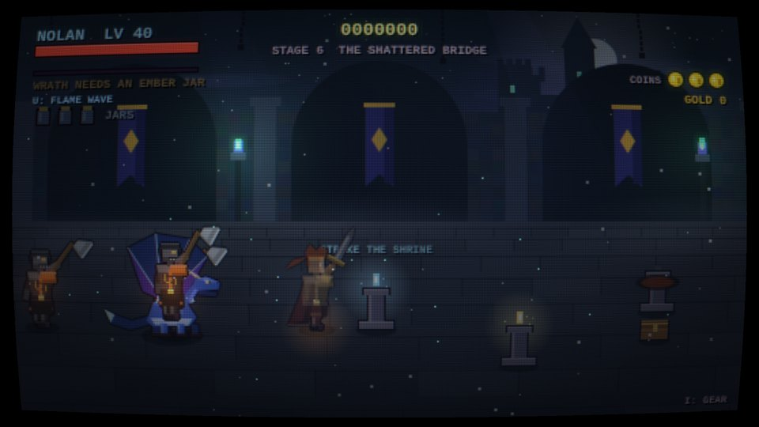 | 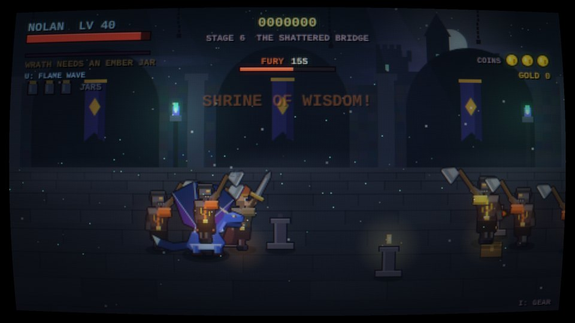 |
| 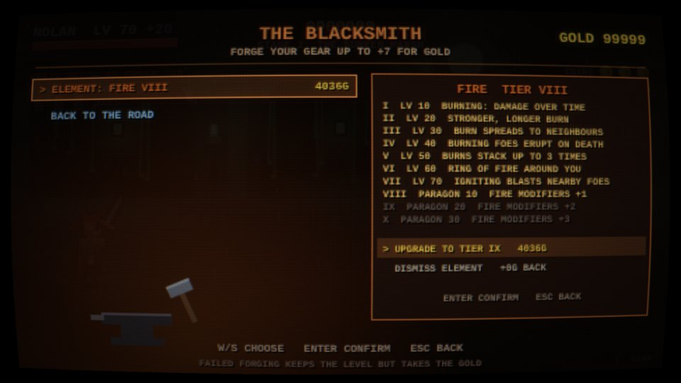 | 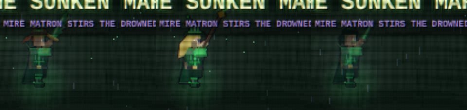 |

## The campaign: seven acts, thirty-five stages
The story runs through **35 stages in seven acts**, and Nolan (or Panni, or Luca) has to recover **seven Heart-Embers**. Each act ends with an Ember Wyrm; the old bosses return stronger (Colossus II up to Wyrm VII) in new places such as the Drowned Cathedral, the Withered Wilds, the Gilded Dunes, the Eclipse Gate and the World-Forge. Levelling is paced to the whole story: **level 70 arrives around stage 33** if you clear everything. After the last stage the Ashen Cycles keep going for as long as you like.

Every act has its own palette and weather: Act I keeps the original embers, Act II turns to frost and snow, Act III to deep crimson with ash and storms, Act IV to a sickly green with rain, Act V to golden sand and sparks, Act VI to a dark blood eclipse with storms, and Act VII to violet with drifting light motes. Monster health also rises with every act.

| | |
|---|---|
| 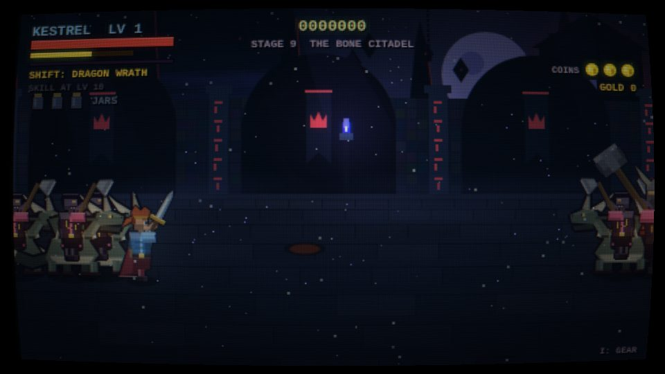 |  |


## Progression and difficulty
- Monsters get tougher every stage, and the campaign loops as **Ashen Cycles**: beat the Ember Wyrm, press Enter and the realm returns stronger, with a free continue coin. 
- A new **special skill every 10 levels** (U casts, Q swaps): Rising Slash, Dash Strike, Whirlwind, Flame Wave, Meteor Dive, Ember Nova and Heart-Ember Burst (lv 70, heals the party).
- Items have an **item level** and a level requirement; stronger levels roll stronger stats.
- **After every boss** you get 25 seconds of loot time (Enter skips it), then the **Ember Market** opens. Kills pay gold, and a **duplicate item** is turned into gold and score instead of clogging your pack. Spend gold on a full heal, a continue coin or fresh gear. From stage 3 the market has a small mythic and legendary chance on every shelf, and a **premium shelf** (about 6% mythic, 30% legendary or better), so you can buy a mythic with your gold instead of waiting for a drop. Unspent gold counts for score when you finish.
- Monsters hit and endure a little harder every stage and cycle.
- Drop rates: magic 34% from stage 2, legendary 7% from stage 3, mythic 1% from stage 4.

- **Stage hazards:** ember vents on stages 2 to 5 glow, then erupt; step off them, or lure monsters on.


### Story portraits and living bosses
Every story scene now shows a framed portrait of Nolan facing the boss of the coming stage. Bosses breathe, the Mire Matron hovers with circling spirit lights, the Forgemaster smokes, the Cinder King beats flame wings and the Colossus shakes the ground as he walks.

| | |
|---|---|
| 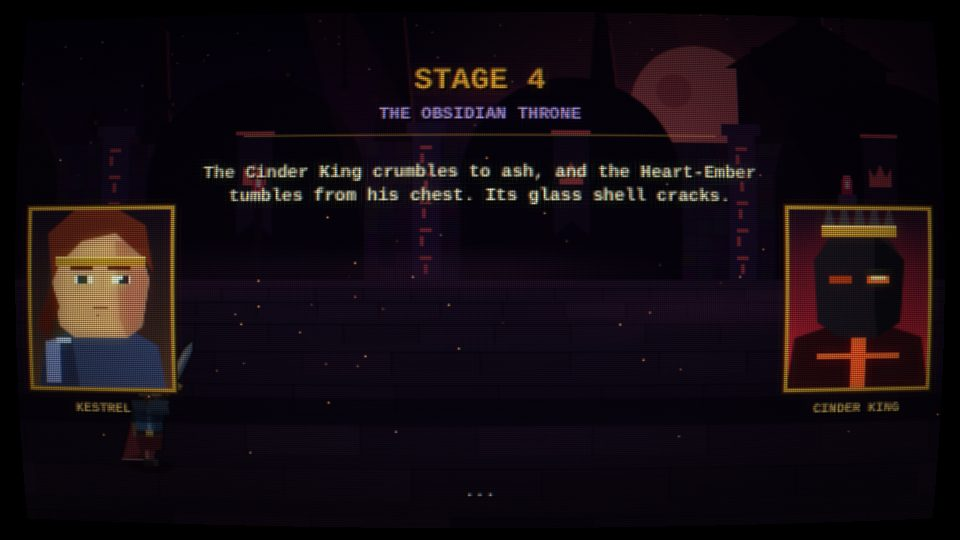 | 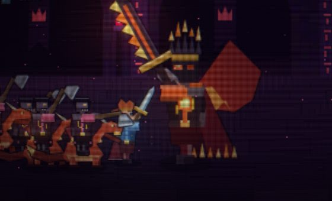 |

### Mounts
Wyrmlings come in three kinds, and a thrown-off rider can grab a loose one with K:

| Wyrmling | Stage | Speed / jump / health | Attack |
|---|---|---|---|
| Ember | 1+ | medium | Three pulses of flame breath |
| Storm | 2+ | fast, high jump, fragile | Chain lightning that leaps between up to three foes |
| Stone | 3+ | slow, low jump, tough | Shockwave along the ground, and a stomp when it lands |

You can fire while jumping. Any hit throws you off, but the wyrmling waits for you. Get thrown a second time, or wear it out, and it bolts for good.

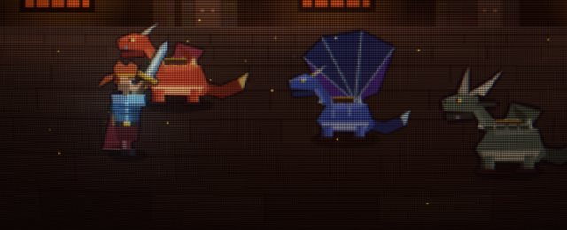

## A new look (v1.38)
Every figure was redrawn from design boards. The principles: a strong silhouette, 3-4 tone colour ramps with cool shadows and warm lights, outlines in a dark shade of the figure's own colour instead of black, a thin **elemental rim light** on the back edge (the hero's fire, frost or lightning; gold for elites; a boss's own power) and secondary motion (breathing, a lagging plume, scarf and robe).

| | |
|---|---|
| 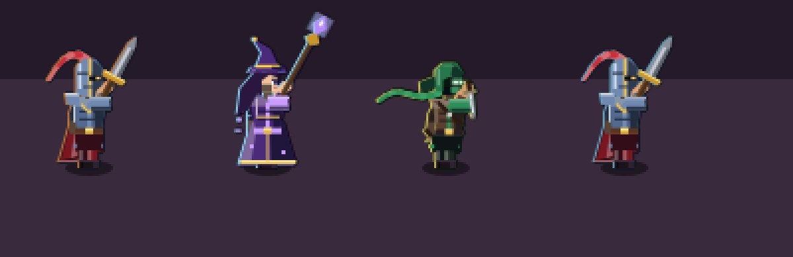 | 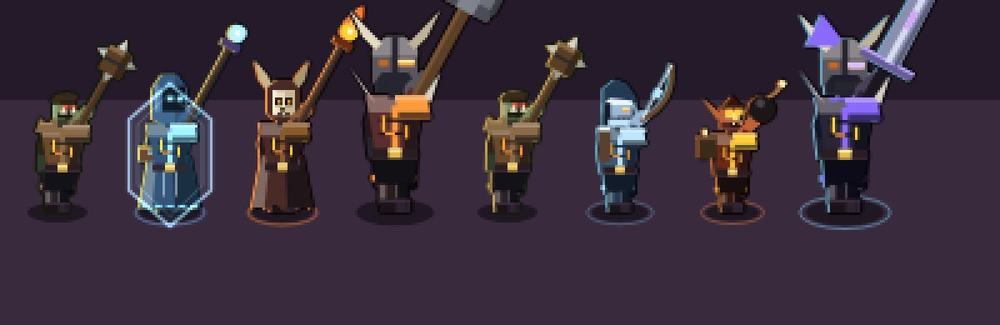 |

- **Foes by role:** the **Marauder** (the melee foe) is hunched and olive-skinned with a fur collar, tusks, red eyes and a spiked club it raises before a swing; the **Ash Warder** is a faceless blue hood inside a hexagonal barrier that cracks as it wears down; the **Flame Caller** wears a horned skull mask and its blast marker is a dashed ring; **wyrmlings** have belly scales, a spiked back, a gold-striped saddle and sparks drifting from the snout. Colour tells the type: earth tones for brawlers, cold blue for casters, the foe's own element for elementals.
- **Bosses:** an obsidian **Cinder King** with flame wings, a **Colossus** with a tiny one-eyed head and turquoise runes, a pale **Mire Matron** with a thorn crown and ghostly clawed arms, a **Forgemaster** with goggles and a braided red beard. Each boss glows brighter before a big hit, an armour plate bursts off at half health, and its life bar takes the boss's own colour.

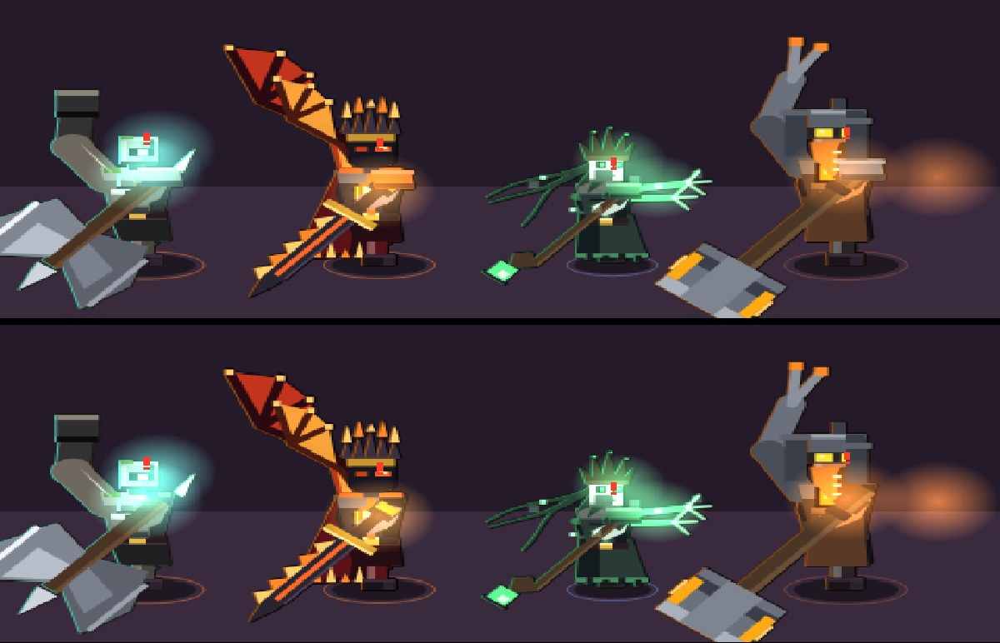

## Daily challenge
Press **3** on the title screen (or **T**, or tap the daily line), read the rules page, pick a hero and race with a fresh level-1 hero, one continue coin and no gold. **The goal is level 70 + 100 paragon: the shortest play time wins** (pauses, shops and story pages do not count). The stages keep coming, tougher every round, until you get there. Your run is kept on the device for the day and resumes from the start of your last stage, and the daily board shows the time (equal times: whoever finished first). Winning earns your saved hero one **daily crown** a day, shown beside its level; your real hero's level, gear and save are never touched. One of five rules applies each day, in a fixed rotation that repeats every five days and changes at your device's midnight:

| Rule | Effect |
|---|---|
| **Gold Rush** | all gold is doubled |
| **Glass Cannon** | you hit 50% harder and take 50% more damage |
| **Iron Foes** | foes have 50% more life and pay 50% more XP and gold |
| **Swift Foes** | every monster is 20% faster |
| **Treasure Day** | twice the chests, more golden ones |

Each day has its own leaderboard. By default it is stored in your browser (so your phone and your PC keep separate boards); the developer can switch on a shared online board with a free Supabase project, see [docs/ONLINE.md](docs/ONLINE.md).

## Fair play
The game runs entirely in your browser, so this is a deterrent, not a lock: its values can't be reached from the browser console, and saves carry a seal. A hand-edited save is set aside (kept under a `_bad` key) and the hero starts fresh. For testing, the developer can open the game with `?max` (and `&stage=N`) on a local file or localhost for a maxed hero; nothing is saved in that mode.

## Support the game
If you enjoyed Emberfall, donations are very welcome and go towards its further development: **[paypal.me/cooldance84](https://www.paypal.com/paypalme/cooldance84)**. The game also shows a clickable donate button on the title and end screens (or press D there).

## Controls

| Action | Player 1 | Player 2 (co-op) | Gamepad | Touch |
|---|---|---|---|---|
| Move | WASD | Arrow keys | Stick or d-pad | Stick |
| Attack (3-hit combo) | J or Z | `,` or numpad 1 | X | ATK |
| Jump / ride a wyrmling | K, X or Space | `.` or numpad 2 | A | JUMP |
| Dragon's Wrath (needs 60 mana) | Shift, L or C | `/` or numpad 3 | B or RB | MAGIC |
| Dismount | E | `'` or numpad 0 | Y | RIDE |
| Gear screen | I or Tab | shared | Select | GEAR |
| Special skill (unlocks every 10 levels) | U | `;` or numpad 4 | LB | SKILL |
| Swap skill | Q | `\` or numpad 5 | LT | SWAP |
| Pause | Esc or P | shared | Start | II |
| Confirm / continue | Enter | shared | A | OK |

Other keys: **F** toggles the CRT filter and **M** mutes. On the title screen **B** opens the leatherboard and **R** (pressed twice) erases your hero.

In the gear screen, Enter equips or swaps an item and X discards it.

## Run locally

Open `index.html` in a browser, or serve the folder:

```
python3 -m http.server
```

## Project layout

```
index.html   page and canvas
game.js      the whole game (engine, art, AI, UI, audio)
i18n.js      Hungarian translation tables
docs/        screenshots used by this README
CHANGELOG.md release notes
```

## Versioning

Emberfall follows [Semantic Versioning](https://semver.org). The current version is shown at the bottom right of the title screen and is the `VERSION` constant at the top of `game.js`. Every release has a git tag (`v1.0.0` and so on) and an entry in [CHANGELOG.md](CHANGELOG.md).

To cut a new release: bump `VERSION` and the badge above, add a changelog entry, commit, then `git tag -a vX.Y.Z -m "..."` and `git push --tags`.
