# EMBERFALL: The Ashen Vow

  

An original side-scrolling arcade brawler in the spirit of the 90s classics. The art, music and sound effects are all generated in code. There are no external assets, no dependencies and no build step.

**Play it:** https://cooldance84.github.io/Emberfall/


## Three heroes
Press Enter (or 2 for co-op) and pick your hero. Each one keeps their own level and gear.

| Hero | Main stat | Style |
|---|---|---|
| **Nolan**, warrior | STR | Sword, 3-hit combo that ends in a knockdown, the most health |
| **Panni**, sorceress | INT | Fires arcane bolts from range; the third cast is a big piercing blast. Fills Dragon's Wrath 50% faster, but has less health |
| **Luca**, rogue | DEX | Twin daggers, fast 4-hit combo, higher crit and speed, jumps higher. Hits from behind are backstabs for +50% damage |

In co-op the second player picks a hero too and shares the first player's level and gear.

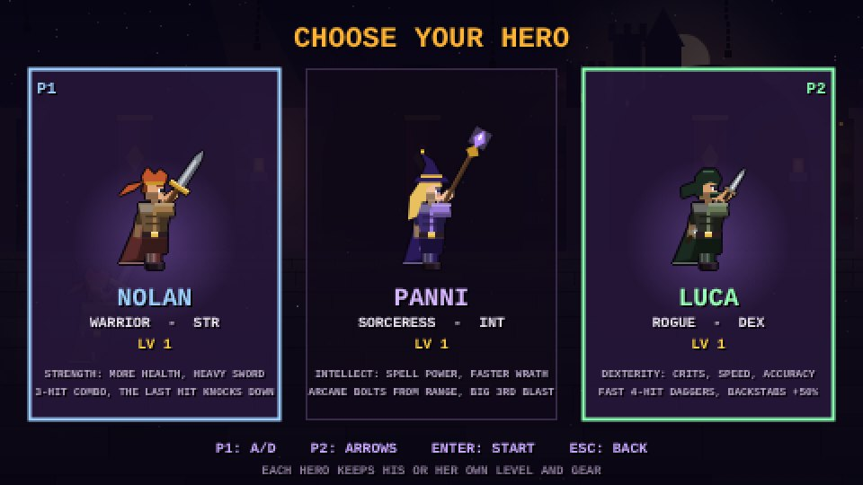

## The story

The Cinder King stole the Heart-Ember and the world went dark. You are Nolan, the last Ember Warden, and you fight through five stages to bring the flame home.

| Stage | Setting | New monster | Boss |
|---|---|---|---|
| 1 | The Broken Gate | Ashen Husk, Cinder Brute | Cinder Colossus |
| 2 | The Sunken Marsh | Bog Wisp (floats, shoots orbs) | Mire Matron |
| 3 | The Ember Forge | Slag Runner (telegraphed dash) | Forgemaster |
| 4 | The Obsidian Throne | Throne Guard (shield blocks light frontal hits) | Cinder King |
| 5 | The Heart-Ember Sanctum | Ember Wraith (teleports behind you) | Ember Wyrm |

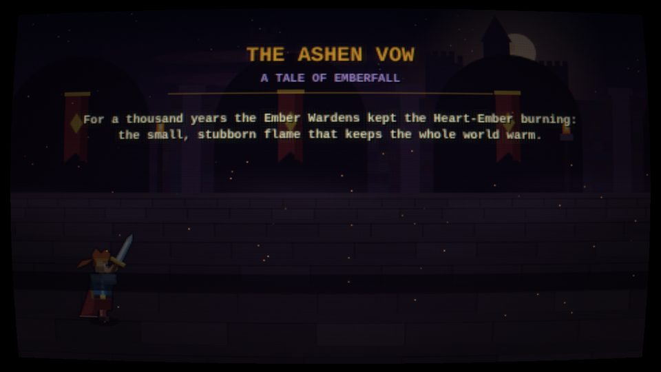

| | |
|---|---|
| 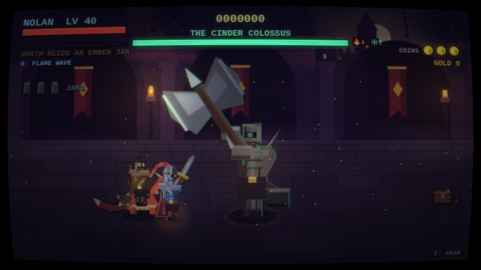 |  |
|  | 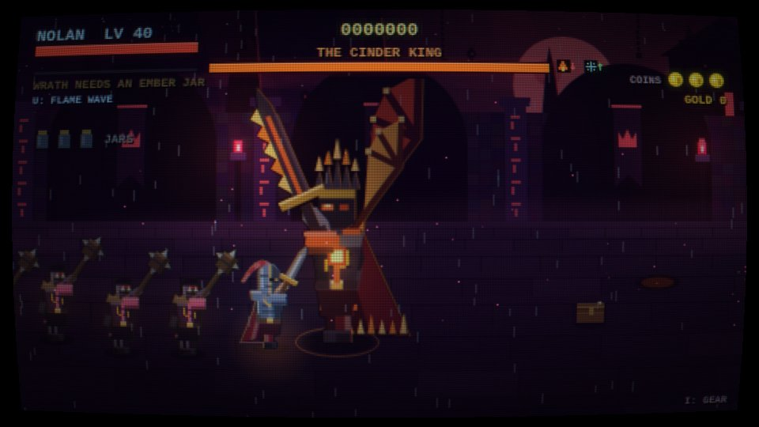 |

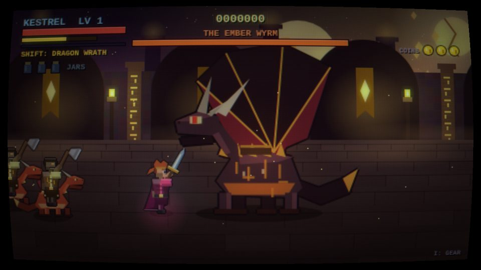

Each boss arrives with a short letterboxed intro, has its own attack set and enrages at half health.


## Features

- **English and Hungarian (magyar):** pick the language on the title screen (click the box or press H) or in the pause menu. English is the default, and your choice is remembered. Translations live in `i18n.js`.
- **Your gear shows on Nolan:** no armour means a leather tunic; each rarity changes the look of the helm (iron cap, visored helm, plumed gold helm, crown of flame), armour (steel, blue, gold with spikes, obsidian with ember cracks), boots, amulet gem and blade (rusty, steel, glowing blue, golden, flaming).
- **New monsters in later acts:** frost archers (act II) shoot arrows you can jump over, blaze bombers (act III) run up and explode in a shockwave, and hollow knights (act IV) leap across the screen and crash down with a shockwave.
- **Articulated bosses:** the Colossus swings a stone back-arm, the Matron reaches with ghostly arms and living hair, the Forgemaster works a tongs arm, and the Cinder King's wings flap on shoulder, elbow, wrist and finger bones.
- **Casters that make you think:** the **Ash Warder** (from stage 2) hides inside an arcane barrier and is untouchable until you shatter it. Light hits barely crack it, heavy blows (third combo hit, jump attack, skills) break it fast, and a broken barrier knocks the warder down. Warders also wrap nearby allies in barriers, so take them out first. The **Flame Caller** (from stage 3) marks the ground under you with runes that explode and leave burning pools, so keep moving.
- **Chasms and barricades:** from stage 1 the road is cut by chasms you must jump over and rubble barricades you have to vault. Falling in costs 60% of your health (and kills you if you are already hurt); knocking a monster into a chasm finishes it off.
- **Sharper fights:** monsters move faster and attack more often, **elite** monsters (gold glow, more health and damage, extra loot) turn up from stage 3, and **ambushes** send fresh foes in from both sides when a wave is nearly beaten.
- **Tougher bosses:** more health and poise, quicker attacks, and they call in escorts when they enrage.
- **Wyrmling mounts:** a rare enemy (at most one per wave) arrives on a small dragon. Knock the rider off, then press K next to the wyrmling to ride it and breathe fire with J.
- **Dragon's Wrath (Shift):** a giant dragon head smashes the whole screen. Goblin pilferers carry **Ember Jars**: each jar you take adds +15% wrath damage, up to three jars (+45%).
- **RPG layer:** levels up to **70**. Items roll **STR, crit chance, crit damage and hit chance**. Gear has six slots (helm, armor, boots, weapon, ring, amulet), and what you wear shows on the hero.
- **Loot by stage:** five rarities: common (white), magic (blue), rare (yellow), legendary (orange) and mythic (crimson). Stage 1 drops only white items, stage 2 adds magic, stage 3 adds rare and legendary, and mythic appears from stage 4.
- **The Blacksmith:** after the market at the end of every stage, forge your weapons up to **+7** for gold. Each level adds 10% to the weapon's stats and +2 to your main stat; from +4 a forge can fail and eat the gold.
- **3 continue coins** per run, and you can buy more in the Ember Market (up to 9; each one past the third costs more). Unspent coins are worth 1,500 points each when you win.
- **Runs are saved on your device:** close the game mid-campaign and pick the same hero later to continue the stage for **one continue coin**, or start over. With no coins left, the run is over.
- **Monsters grow with the story:** every act adds a layer of monster health (+20%, +45%, +75%), and a hero far above the stage's level meets monsters of their own level.
- **Leatherboard:** top 10 scores with initials. Your character, gear, settings and the board are saved in your browser.
- **2-player co-op:** press **2** on the title screen.
- **Procedural music** for each stage, a **pause menu**, **gamepad** and **touch** support.
- **CRT and bloom shader** (WebGL), per-stage lighting, fog and parallax.

| | |
|---|---|
| 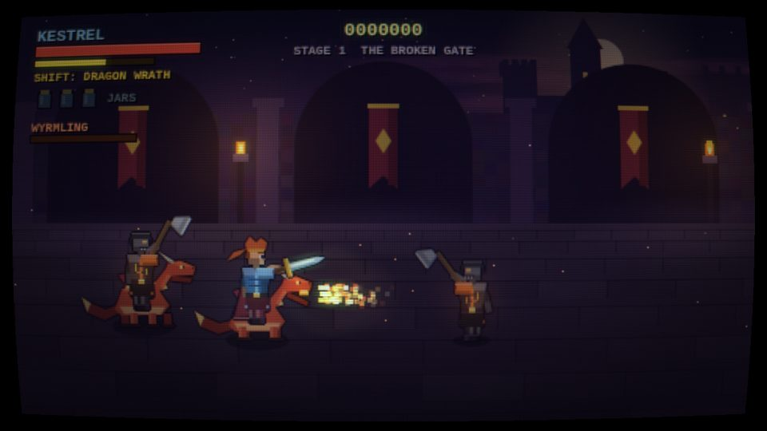 |  |
| 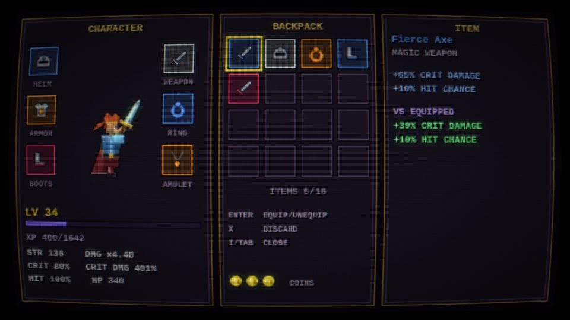 | 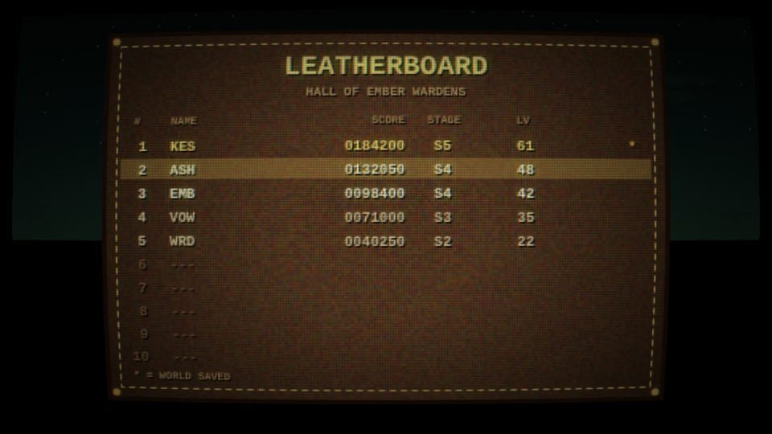 |
| 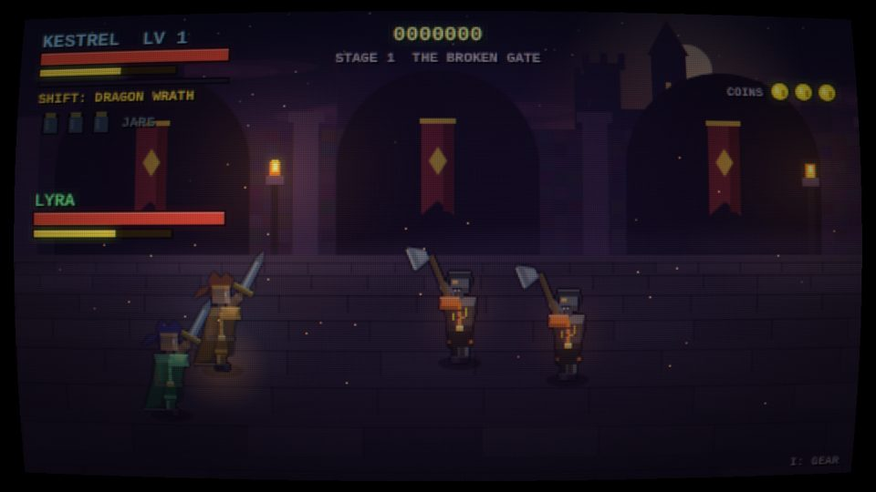 |  |
|  | 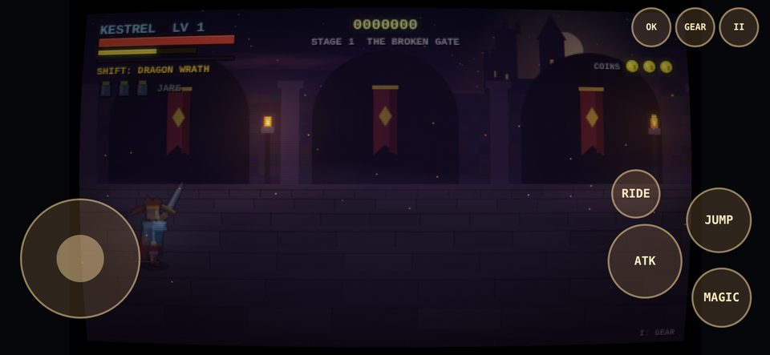 |
| 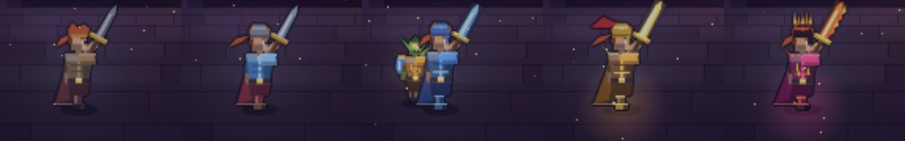 | 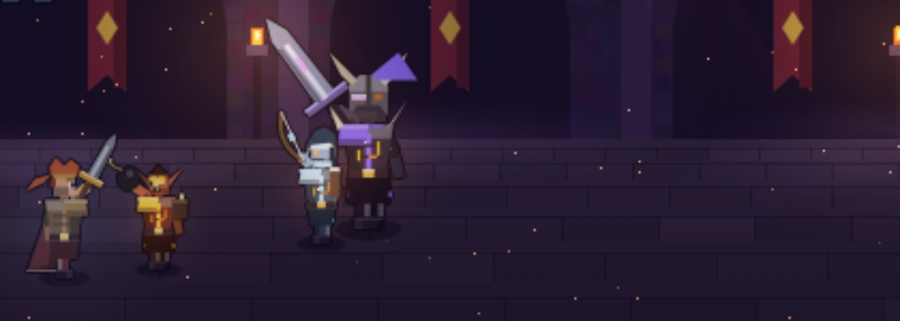 |
| 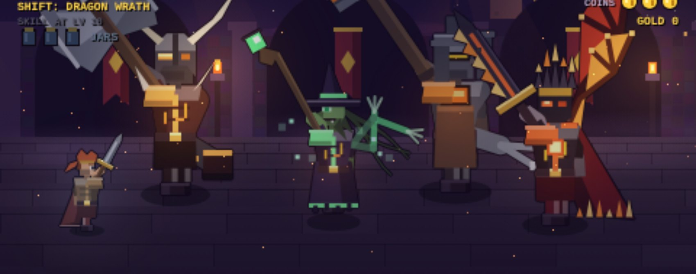 |  |

## The campaign: seven acts, thirty-five stages
The story runs through **35 stages in seven acts**, and Nolan (or Panni, or Luca) has to recover **seven Heart-Embers**. Each act ends with an Ember Wyrm; the old bosses return stronger (Colossus II up to Wyrm VII) in new places such as the Drowned Cathedral, the Withered Wilds, the Gilded Dunes, the Eclipse Gate and the World-Forge. Levelling is paced to the whole story: **level 70 arrives around stage 33** if you clear everything. After the last stage the Ashen Cycles keep going for as long as you like.

Every act has its own palette and weather: Act I keeps the original embers, Act II turns to frost and snow, Act III to deep crimson with ash and storms, Act IV to a sickly green with rain, Act V to golden sand and sparks, Act VI to a dark blood eclipse with storms, and Act VII to violet with drifting light motes. Monster health also rises with every act.

| | |
|---|---|
|  | 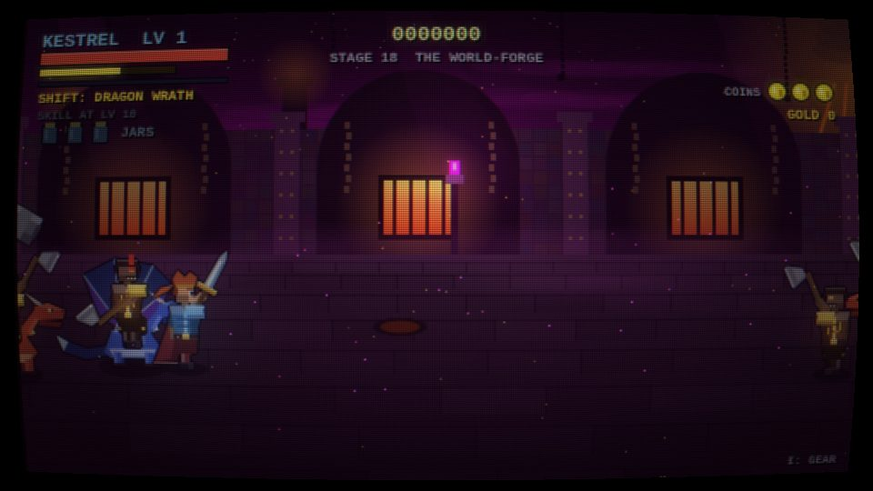 |

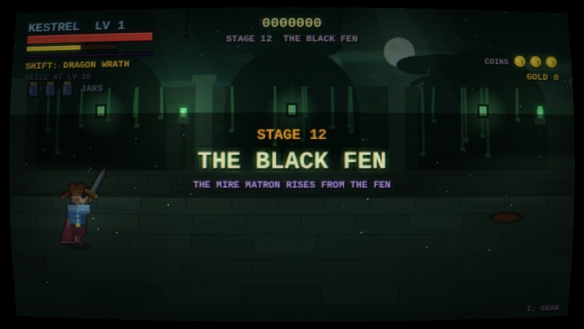

## Progression and difficulty
- Monsters get tougher every stage, and the campaign loops as **Ashen Cycles**: beat the Ember Wyrm, press Enter and the realm returns stronger, with a free continue coin. 
- A new **special skill every 10 levels** (U casts, Q swaps): Rising Slash, Dash Strike, Whirlwind, Flame Wave, Meteor Dive, Ember Nova and Heart-Ember Burst (lv 70, heals the party).
- Items have an **item level** and a level requirement; stronger levels roll stronger stats.
- **After every boss** you get 25 seconds of loot time (Enter skips it), then the **Ember Market** opens. Kills pay gold, and a **duplicate item** is turned into gold and score instead of clogging your pack. Spend gold on a full heal, a continue coin or fresh gear. From stage 3 the market has a small mythic and legendary chance on every shelf, and a **premium shelf** (about 6% mythic, 30% legendary or better), so you can buy a mythic with your gold instead of waiting for a drop. Unspent gold counts for score when you finish.
- Monsters hit and endure a little harder every stage and cycle.
- Drop rates: magic 34% from stage 2, legendary 7% from stage 3, mythic 1% from stage 4.

- **Stage hazards:** ember vents on stages 2 to 5 glow, then erupt; step off them, or lure monsters on.

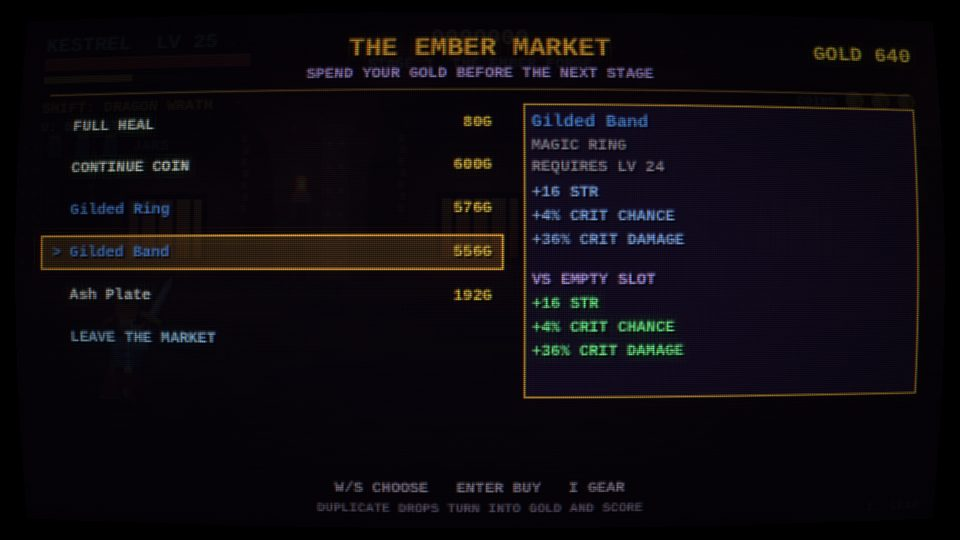

### Story portraits and living bosses
Every story scene now shows a framed portrait of Nolan facing the boss of the coming stage. Bosses breathe, the Mire Matron hovers with circling spirit lights, the Forgemaster smokes, the Cinder King beats flame wings and the Colossus shakes the ground as he walks.

| | |
|---|---|
|  |  |

### Mounts
Wyrmlings come in three kinds, and a thrown-off rider can grab a loose one with K:

| Wyrmling | Stage | Speed / jump / health | Attack |
|---|---|---|---|
| Ember | 1+ | medium | Three pulses of flame breath |
| Storm | 2+ | fast, high jump, fragile | Chain lightning that leaps between up to three foes |
| Stone | 3+ | slow, low jump, tough | Shockwave along the ground, and a stomp when it lands |

You can fire while jumping. Any hit throws you off, but the wyrmling waits for you. Get thrown a second time, or wear it out, and it bolts for good.


## Support the game
If you enjoyed Emberfall, donations are very welcome and go towards its further development: **[paypal.me/cooldance84](https://www.paypal.com/paypalme/cooldance84)**. The game also shows a clickable donate button on the title and end screens (or press D there).

## Controls

| Action | Player 1 | Player 2 (co-op) | Gamepad | Touch |
|---|---|---|---|---|
| Move | WASD | Arrow keys | Stick or d-pad | Stick |
| Attack (3-hit combo) | J or Z | `,` or numpad 1 | X | ATK |
| Jump / ride a wyrmling | K, X or Space | `.` or numpad 2 | A | JUMP |
| Dragon's Wrath (needs 60 mana) | Shift, L or C | `/` or numpad 3 | B or RB | MAGIC |
| Dismount | E | `'` or numpad 0 | Y | RIDE |
| Gear screen | I or Tab | shared | Select | GEAR |
| Special skill (unlocks every 10 levels) | U | `;` or numpad 4 | LB | SKILL |
| Swap skill | Q | `\` or numpad 5 | LT | SWAP |
| Pause | Esc or P | shared | Start | II |
| Confirm / continue | Enter | shared | A | OK |

Other keys: **F** toggles the CRT filter and **M** mutes. On the title screen **B** opens the leatherboard and **R** (pressed twice) erases your hero.

In the gear screen, Enter equips or swaps an item and X discards it.

## Run locally

Open `index.html` in a browser, or serve the folder:

```
python3 -m http.server
```

## Project layout

```
index.html   page and canvas
game.js      the whole game (engine, art, AI, UI, audio)
i18n.js      Hungarian translation tables
docs/        screenshots used by this README
CHANGELOG.md release notes
```

## Versioning

Emberfall follows [Semantic Versioning](https://semver.org). The current version is shown at the bottom right of the title screen and is the `VERSION` constant at the top of `game.js`. Every release has a git tag (`v1.0.0` and so on) and an entry in [CHANGELOG.md](CHANGELOG.md).

To cut a new release: bump `VERSION` and the badge above, add a changelog entry, commit, then `git tag -a vX.Y.Z -m "..."` and `git push --tags`.
